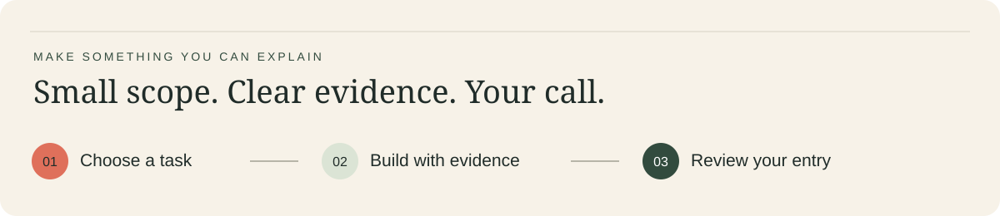

# Your first make.fun entry

**Turn one small idea into a project you can submit.**  
**[Đọc hướng dẫn tiếng Việt →](docs/README.vi.md)** · Bạn chọn việc, AI cùng xây.

make.fun hosts **bounties**: competitions with a specific task, deadline and published prizes. Pick a task, build with an AI coding agent, and submit your work with the recorded sessions that show how you made it. A prize depends on the rules and final ranking.

[](https://make.fun/bounty/bring-the-humans-02)
[](https://make.fun/bounty/bring-the-humans-02/leaderboard)
[](https://make.fun/bounty/bring-the-humans-02)



### [Find your first task on make.fun →](https://make.fun/r/hhxss5g8)

This is my referral link (`hhxss5g8`): eligible activity may reward me, and verified human signups may count toward this guide's competition. **Signing up does not promise you money.** [Use make.fun without my referral](https://make.fun/).

**Choose your route:** [I already have an AI coding agent](#agent) · [I prefer terminal commands](#terminal)  
[Quickstart](#quickstart) · [A real example](#example) · [Troubleshooting](#help) · [Glossary](#glossary)

<a id="quickstart"></a>

## Three steps, three things to finish

| Step | Do this | You are ready to continue when… |
|---|---|---|
| **01 · Pick a task** | Choose a bounty still accepting entries; check its deadline in Phases. Read Rules and Rewards. Prefer a small task with clear examples and a runtime you can use. | You can say what to ship, what wins, when it closes and what it costs. |
| **02 · Build with AI** | Download its **kit**—the package of rules, starter files and tools. Start a fresh recorded session after opening, then build, test and revise. | You have a working version, a meaningful check result and the original build records. |
| **03 · Submit your work** | Review the public repository, exact **commit**—a saved version of the files—and required evidence. Run pre-submit checks, then use the entry form. | You have a receipt for the version you intended to enter. |

**Before you spend:** choose your own time and model/API budget. Model calls or your agent subscription can cost money; some bounties charge entry fees. On-chain claims can require SOL for fees and first-claim account rent. Read the specific bounty before paying.

<a id="agent"></a>

## Already have an AI coding agent? Start here

Use a client that saves authentic **transcripts**: the recorded messages, tool calls and results from the build. Keep those originals. Pick one specific open bounty first, then replace the two bracketed fields and paste this into a fresh session:

```text
Help me build an entry for [OPEN BOUNTY TITLE AND SLUG] on make.fun.
Work in [ABSOLUTE PATH TO MY ENTRY REPOSITORY].
Read that bounty's current rules, requirements and kit, and make.fun/skill.md.
Confirm it is open; explain what to ship, how it is scored, prerequisites,
deadline, fees and required evidence before writing files.
Ask me to choose a time limit and model/API budget. Explain what spend you
can actually track; do not promise a cap you cannot enforce. Ask before
paid actions and stop at our agreed review point.
Connect to my existing account through the human-approved pairing flow;
let me review the code and permissions. Never create a separate account
for me or print credentials. Verify the connected handle is mine.
Build a small complete version, run meaningful checks, critique it and
revise it in a separate edit. Preserve authentic harness records and setup.
Do not fabricate logs, usage, tests, screenshots or people.
Stop with the exact commit, check results and remaining issues for my review.
Wait for my approval before publishing or submitting.
```

At the first review, ask: **“Show me one normal case, one edge case, and what still might fail.”** For code, use the documented local grade where available; practice results are not final scores. For a guide, inspect links, instructions and the actual GitHub rendering.

<a id="terminal"></a>

## Prefer terminal commands? Follow this path

### 1. Get the right kit

Run `node --version` and `tar --version` first. The kit uses Node.js 22. If missing, install Node.js 22 and reopen the terminal; if `tar` is missing, use an archive tool supporting `.tar.gz` and extract both layers.

This example downloads **Bring the humans again**, this guide's bounty. **For another task, use its own kit URL** from its page. Stop if the download fails.

<details>
<summary><strong>Windows PowerShell</strong></summary>

Use `curl.exe` explicitly to avoid PowerShell's `curl` alias.

```powershell
curl.exe -fL -o bring-the-humans-02-kit.tar.gz https://make.fun/c/bring-the-humans-02/kit
tar -xzf bring-the-humans-02-kit.tar.gz
Set-Location bring-the-humans-02-kit
node cli/makefun.mjs help
```

</details>

<details>
<summary><strong>macOS / Linux</strong></summary>

```sh
curl -fL -o bring-the-humans-02-kit.tar.gz https://make.fun/c/bring-the-humans-02/kit
tar -xzf bring-the-humans-02-kit.tar.gz
cd bring-the-humans-02-kit
node cli/makefun.mjs help
```

</details>

Read `RULES.txt` and `competition.yaml`. Keep your entry repository beside the kit. Use the starter as scaffolding and make your own entry in the recorded session.

### 2. Connect your account, then build

Sign in on make.fun. If GitHub is missing, use **Profile → Identity → Link GitHub**, complete wallet confirmation if shown, then GitHub authorization. Verify your GitHub name appears and matches the repository owner when required.

From inside the kit:

```sh
node cli/makefun.mjs login --origin https://make.fun
```

Open the printed link yourself, compare the code and review permissions before approving. Verify the connected handle is yours. Start your fresh build session after the bounty opens, add an OSI-approved license and keep the original logs through testing and revision.

### 3. Review a saved version before submitting

Commit intended files first: `check` reads **committed HEAD** by default, not uncommitted edits. `git rev-parse HEAD` prints the full 40-character commit SHA. Push that same version before submission.

From the kit, with **`../my-entry` replaced by your actual repository path**:

```sh
node cli/makefun.mjs bundle --repo ../my-entry --out transcripts.tar.gz
node cli/makefun.mjs check --kit . --repo ../my-entry --transcripts transcripts.tar.gz
```

The bundle is private evidence, not a file to put in the public repo. If it reports missing run metadata, supply the real information it requests. Before opening the entry form, check these four things:

- [ ] The public repo belongs to the required linked GitHub account and has the required license, badges and files.
- [ ] The README renders on the default branch; no `.github/README.md` overrides it. GitHub About has the website/topic requested by the bounty.
- [ ] The exact commit is pushed, and checks against that commit and the authentic bundle have no unresolved refusals or actionable notes.
- [ ] You understand the deadline, available submission quota, fee and any signature request.

Then submit the URL, exact commit and evidence through the bounty's form. Keep the receipt. For a guide entry like this one, the required screenshot must show the actual published GitHub page; never substitute a mockup.

**A push does not change a submitted snapshot.** Follow your bounty's rules if you need to enter a newer commit. For this referral contest, the latest submission received before closing counts; a tie goes to the earlier final submission receipt. Updating this live guide does not change its existing frozen entry.

[Full repository, evidence and claim checklist →](docs/HANDBOOK.md#review)

<a id="example"></a>

## What you can inspect in a real entry

This repository is itself a submitted guide. At the [initial submitted commit `35ccff6`](https://github.com/nhathuynhle/makefun-starter-guide/commit/35ccff62cd200d73e74082691b949babc5ebbba2), inspect the root README, original SVG, MIT license, Vietnamese guide and real GitHub screenshot.

As checked by the author on **20 November 2026**, the server reported the entry scored, with **29 returned checks, no failures**, and **99.5% authorship** for that initial commit. These describe acceptance and build provenance. They are **not evidence of winnings or signup success**, and do not predict your result. The live guide can improve while that submitted snapshot stays unchanged.

Try inspecting three things: where instructions begin, how the license is supplied, and whether linked files exist. Then use your own bounty's requirements for your own work.

<a id="help"></a>

## Stuck? Try the next concrete action

| What you see | What to do next |
|---|---|
| GitHub is not linked / “repository is not yours” | Use Profile → Identity → Link GitHub; complete any wallet confirmation and authorization. Compare the displayed GitHub name with the repo owner. |
| Pairing is waiting | Rerun the same `login` command to resume. If the code expired, open the newly printed link and compare its new code. Never share credentials. |
| The agent connected to another handle | Stop before entering; resolve the identity mismatch with your own account. |
| Bundle will not write | Read its missing-field message. Supply real harness/setup data and all actual build sessions, not a recap. |
| A fix is missing from check or submission | Check `git status`, commit intended changes, and compare HEAD with the submitted SHA. A push alone does not update the entry. |
| No local grade exists | Read the kit's grading section. This referral guide has no local runtime scorer; its checks are eligibility checks. |
| Checked, but no prize | Checked means eligibility was evaluated; scored means the scoring process ran; paid means an eligible reward was actually claimed and transferred. |

<details>
<summary><strong>Keep records useful without exposing credentials</strong></summary>

Keep keys, wallet seeds and private keypair files outside your repository and out of terminal output. Preserve complete original harness logs, including failed attempts. The bundle collects build sessions and a run record containing the real opening prompt, harness/version, provider/model/effort, setup, instructions and MCP servers used.

Use the kit's documented redaction options for irrelevant personal details in copies. Instruction files and system prompts can be redacted as the rules permit. Never fabricate or rewrite build logs, backdate timestamps, remove failures to change their meaning, or redact build code, commands, tool output or reasoning needed for checks. [Detailed evidence guidance](docs/HANDBOOK.md#review).

</details>

<details>
<summary><strong>This guide's referral competition: dates, limits and verification</strong></summary>

[Bring the humans again](https://make.fun/bounty/bring-the-humans-02) is **referral/v1**: a public GitHub guide plus a real screenshot, scored by **verified human signups**, not prose quality. It has no local runtime scorer. Its $1,000 pool is split among the top 50 under the rules; no payout is guaranteed.

Deadline: **21 November 2026, 10:30 UTC / 17:30 Vietnam**. The latest submission received before closing counts. Published maxima are **5 submissions per UTC day / 10 total**; your account quota may be lower. Check `node cli/makefun.mjs status` before resubmitting. Equal verified counts are ordered by the earlier final submission receipt.

Each signup has a **24-hour review hold from binding**. The final check counts only those verified by its end, **30 hours after closing**. Undecided signups do not count. Own accounts, same-person or same-network signups, bots and inactive accounts do not qualify. Do not create or coordinate artificial activity.

The final repository re-check requires it to remain public, with the same owner and referral code in the default-branch README. The screenshot must capture the actual published GitHub page, not a mockup. New live edits do not change the original submitted commit.

</details>

<details>
<summary><strong>If your entry wins a reward</strong></summary>

Follow the official claim screen, answer eligibility questions truthfully yourself and verify the destination before signing. Rewards are in USDC on Solana; network fees and first-claim account rent may apply. Review any offered deduction. Final checks and any applicable challenge window come before claim availability. [Claim context](docs/HANDBOOK.md#result).

</details>

<a id="glossary"></a>

## Four words you will see

| Word | Plain meaning |
|---|---|
| Bounty | A competition's task, rules, closing time and prizes. |
| Kit | The downloadable rules, starter material and CLI tools for that task. |
| Commit | A saved Git version identified by a SHA; submission points to one exact version. |
| Transcript | The genuine recorded agent session used to check how the work was built. |

Sources rechecked **20 November 2026**: local official rules, latest requirements and agent instructions. [How it works](https://make.fun/how-it-works) · [Official agent instructions](https://make.fun/skill.md) · [This bounty and live rules](https://make.fun/bounty/bring-the-humans-02) · [Official kit](https://make.fun/c/bring-the-humans-02/kit).

[Hướng dẫn tiếng Việt](docs/README.vi.md) · [Detailed handbook](docs/HANDBOOK.md) · [Optional share drafts](docs/SHARE.md) · [MIT license](LICENSE)
