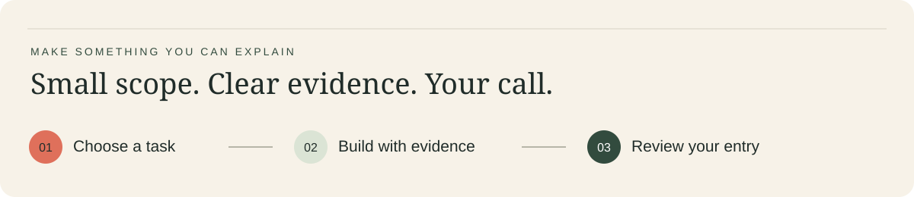

# Bài make.fun đầu tiên của bạn

**Chọn một việc nhỏ. Cùng AI làm cho xong. Xem lại rồi mới gửi.**  
[← English guide](../README.md)

make.fun có các **bounty**: cuộc thi với đề bài, hạn chót và giải thưởng được công bố. Bạn chọn việc, cùng AI coding agent xây sản phẩm, rồi nộp sản phẩm kèm bản ghi phiên làm việc để chứng minh quá trình tạo ra nó. Có nhận giải hay không phụ thuộc luật và thứ hạng cuối.



### [Tìm bài đầu tiên trên make.fun →](https://make.fun/r/hhxss5g8)

Đây là link giới thiệu của mình, mã `hhxss5g8`: hoạt động đủ điều kiện có thể mang lại thưởng cho mình; signup người thật được xác minh có thể tính vào cuộc thi của hướng dẫn này. **Đăng ký không có nghĩa bạn được trả tiền.** [Vào make.fun không qua link giới thiệu](https://make.fun/).

**Chọn cách bắt đầu:** [Tôi đã có AI coding agent](#agent) · [Tôi muốn dùng terminal](#terminal)  
[Ba bước nhanh](#quickstart) · [Ví dụ thật](#example) · [Gỡ vướng](#help) · [Từ điển nhỏ](#glossary)

<a id="quickstart"></a>

## Ba bước, mỗi bước một kết quả

| Bước | Làm gì | Khi nào chuyển bước? |
|---|---|---|
| **01 · Chọn bài** | Chọn bounty còn nhận bài; kiểm tra hạn nộp trong Phases, rồi đọc Rules và Rewards. Chọn bài nhỏ có ví dụ rõ và môi trường bạn chạy được. | Bạn nói được nộp gì, thắng bằng cách nào, hạn chót và chi phí. |
| **02 · Cùng AI xây** | Tải **kit**—gói luật, file mẫu và công cụ của bài. Mở phiên được ghi log sau giờ mở cuộc thi, làm bản đầu, kiểm tra rồi sửa. | Có sản phẩm chạy được, kết quả kiểm tra có ý nghĩa và bản ghi gốc. |
| **03 · Xem lại rồi nộp** | Kiểm tra repo công khai, đúng **commit**—phiên bản file đã lưu bằng Git—và bằng chứng. Chạy check rồi dùng form nộp bài. | Có receipt xác nhận đúng phiên bản bạn định gửi. |

**Trước khi chi tiền:** tự chọn thời gian và ngân sách model/API phù hợp. Model hoặc gói thuê bao agent có thể tốn tiền; một số bounty thu phí vào bài. Claim giải on-chain có thể cần SOL cho phí và rent tạo tài khoản lần đầu. Đọc bài cụ thể trước khi trả phí.

<a id="agent"></a>

## Đã có AI coding agent? Bắt đầu ở đây

Dùng client lưu **transcript** thật: bản ghi các tin nhắn, lần gọi công cụ và kết quả của phiên xây bài. Giữ nguyên bản gốc. Chọn một bounty cụ thể còn mở, thay hai trường trong ngoặc vuông rồi gửi prompt trong phiên mới:

```text
Giúp tôi làm bài [TÊN BOUNTY ĐANG MỞ VÀ SLUG] trên make.fun.
Làm trong [ĐƯỜNG DẪN TUYỆT ĐỐI ĐẾN REPO BÀI CỦA TÔI].
Đọc luật, requirements, kit hiện tại của bài và make.fun/skill.md.
Xác nhận bài còn mở; giải thích sản phẩm cần nộp, cách chấm, điều kiện,
hạn chót, phí và bằng chứng trước khi viết file.
Hỏi tôi chọn giới hạn thời gian và ngân sách model/API. Nói rõ khoản chi
nào bạn đo được; không hứa mức trần bạn không thực thi được. Hỏi trước
hành động trả phí và dừng tại mốc xem lại đã thống nhất.
Ghép agent với tài khoản hiện có của tôi qua bước người dùng phê duyệt;
để tôi xem mã và quyền. Không tạo tài khoản riêng thay tôi hoặc in credential.
Xác nhận handle đã kết nối là của tôi.
Làm bản nhỏ nhưng hoàn chỉnh, kiểm tra có ý nghĩa, tự phê bình rồi sửa
bằng một lượt edit riêng. Giữ bản ghi harness và setup thật.
Không bịa log, usage, test, ảnh chụp hay người dùng.
Dừng với commit chính xác, kết quả check và vấn đề còn lại để tôi xem.
Chờ tôi đồng ý trước khi publish hoặc submit.
```

Ở lượt xem đầu, hỏi: **“Cho tôi xem một ca thường, một ca biên và điều gì vẫn có thể lỗi.”** Với code, chỉ chạy local grade nếu kit có hướng dẫn; điểm practice không phải điểm cuối. Với bài hướng dẫn, xem liên kết, từng bước và cách GitHub thực sự hiển thị.

<a id="terminal"></a>

## Muốn dùng terminal? Đi theo đường này

### 1. Lấy đúng kit

Chạy `node --version` và `tar --version` trước. Kit dùng Node.js 22. Nếu thiếu, cài Node.js 22 rồi mở lại terminal. Nếu thiếu `tar`, dùng công cụ hỗ trợ `.tar.gz` để giải cả hai lớp.

Ví dụ dưới tải **Bring the humans again**, cuộc thi của hướng dẫn này. **Nếu chọn bài khác, lấy URL kit riêng trên trang bài đó.** Tải lỗi thì dừng.

<details>
<summary><strong>Windows PowerShell</strong></summary>

Dùng `curl.exe` để tránh alias `curl` của PowerShell nhận tham số khác.

```powershell
curl.exe -fL -o bring-the-humans-02-kit.tar.gz https://make.fun/c/bring-the-humans-02/kit
tar -xzf bring-the-humans-02-kit.tar.gz
Set-Location bring-the-humans-02-kit
node cli/makefun.mjs help
```

</details>

<details>
<summary><strong>macOS / Linux</strong></summary>

```sh
curl -fL -o bring-the-humans-02-kit.tar.gz https://make.fun/c/bring-the-humans-02/kit
tar -xzf bring-the-humans-02-kit.tar.gz
cd bring-the-humans-02-kit
node cli/makefun.mjs help
```

</details>

Đọc `RULES.txt` và `competition.yaml`. Đặt repo bài bên cạnh kit. File mẫu là khung để phát triển, không phải bài hoàn chỉnh của bạn.

### 2. Kết nối đúng tài khoản rồi xây bài

Đăng nhập make.fun. Nếu chưa có GitHub trong hồ sơ, vào **Profile → Identity → Link GitHub**, xác nhận ví nếu được yêu cầu, rồi cấp quyền GitHub. Kiểm tra tên GitHub hiện ra và khớp chủ repo khi bài yêu cầu.

Đứng trong thư mục kit:

```sh
node cli/makefun.mjs login --origin https://make.fun
```

Tự mở link vừa in ra, đối chiếu mã và xem quyền trước khi duyệt. CLI phải báo đúng handle của bạn. Mở phiên xây bài mới sau giờ mở cuộc thi, thêm giấy phép được OSI chấp thuận và giữ log gốc xuyên suốt quá trình kiểm tra, sửa bài.

### 3. Kiểm tra phiên bản đã lưu trước khi gửi

Commit đủ file trước: `check` mặc định đọc **HEAD đã commit**, không đọc sửa đổi chưa commit. Lệnh `git rev-parse HEAD` in SHA đủ 40 ký tự. Push đúng phiên bản đó trước khi gửi.

Đứng trong kit và **thay `../my-entry` bằng đường dẫn repo thật của bạn**:

```sh
node cli/makefun.mjs bundle --repo ../my-entry --out transcripts.tar.gz
node cli/makefun.mjs check --kit . --repo ../my-entry --transcripts transcripts.tar.gz
```

Bundle là bằng chứng riêng tư, không đưa vào repo công khai. Nếu thiếu metadata, bổ sung thông tin thật mà lệnh yêu cầu. Trước khi mở form, đối chiếu bốn điều:

- [ ] Repo công khai thuộc đúng GitHub đã liên kết theo yêu cầu, đủ license, badge và file bắt buộc.
- [ ] README trên default branch hiển thị đúng; không có `.github/README.md` ghi đè. About có website/topic mà bài yêu cầu.
- [ ] Đã push đúng commit; check commit đó cùng bundle thật không còn lỗi từ chối hay ghi chú cần xử lý.
- [ ] Bạn hiểu hạn chót, quota còn dùng, phí và yêu cầu ký nếu có.

Sau đó gửi URL, commit chính xác và bằng chứng qua form; giữ receipt. Với bài guide như repo này, ảnh bắt buộc phải chụp trang GitHub đã publish thật, không thay bằng mockup.

**Push không đổi snapshot đã nộp.** Đọc luật bài nếu cần gửi commit mới. Với cuộc thi referral này, lần gửi cuối được nhận trước hạn là bài được tính; đồng điểm thì receipt bài cuối sớm hơn đứng trước. Nâng cấp guide đang hiển thị không thay đổi bài đã chốt theo commit cũ.

[Checklist repo, log và claim chi tiết bằng tiếng Anh →](HANDBOOK.md#review)

<a id="example"></a>

## Một bài thật để bạn mở ra xem

Repo này là một hướng dẫn đã nộp. Ở [commit nộp ban đầu `35ccff6`](https://github.com/nhathuynhle/makefun-starter-guide/commit/35ccff62cd200d73e74082691b949babc5ebbba2), bạn có thể xem README gốc, SVG nguyên bản, MIT license, bản tiếng Việt và ảnh chụp GitHub thật.

Theo kiểm tra của tác giả ngày **20/11/2026**, server báo bài đã scored, **29 check được trả về, không lỗi**, và **99,5% authorship** ở commit ban đầu. Đây là thông tin về kiểm tra đầu vào và nguồn gốc công việc, **không chứng minh có giải hoặc có signup thành công**, cũng không dự báo kết quả của bạn. Guide đang đọc có thể được cải thiện trong khi snapshot đã nộp vẫn giữ nguyên.

Thử xem ba điều: hướng dẫn bắt đầu từ đâu, license được đặt thế nào và các file liên kết có thật không. Khi làm bài riêng, vẫn theo yêu cầu bounty của bạn.

<a id="help"></a>

## Gỡ vướng bằng bước tiếp theo cụ thể

| Bạn gặp gì? | Làm tiếp thế nào? |
|---|---|
| Chưa liên kết GitHub / repo “không thuộc bạn” | Vào Profile → Identity → Link GitHub, xác nhận ví nếu có rồi cấp quyền. So tên GitHub trong hồ sơ với owner của repo. |
| Ghép agent vẫn chờ | Chạy lại cùng lệnh `login`. Nếu mã hết hạn, mở link mới vừa in ra và đối chiếu mã mới. Không chia sẻ credential. |
| Agent kết nối nhầm handle | Dừng trước khi gửi bài, xử lý đúng danh tính tài khoản của bạn. |
| Bundle không ghi file | Đọc trường còn thiếu; dùng dữ liệu harness/setup và mọi phiên thật, không thay bằng bản tóm tắt. |
| Check hoặc bài gửi chưa có phần sửa | Xem `git status`, commit phần định gửi và so HEAD với SHA đã nộp. Push riêng không cập nhật bài. |
| Không có local grade | Đọc phần chấm trong kit. Guide referral này không có scorer cục bộ; check là kiểm tra điều kiện. |
| Qua check mà chưa có tiền | Checked là kiểm tra điều kiện; scored là đã chấm theo cơ chế bài; paid là giải đủ điều kiện đã claim và chuyển. |

<details>
<summary><strong>Giữ bằng chứng mà không lộ credential</strong></summary>

Để key, seed ví và file private keypair ngoài repo; không in chúng ra terminal. Giữ log gốc đầy đủ, cả lần lỗi. Bundle thu thập phiên xây bài và run record gồm prompt thật ban đầu, harness/phiên bản, provider/model/effort, setup, instruction files và MCP đã dùng.

Dùng tùy chọn redaction được tài liệu cho phép cho chi tiết cá nhân không liên quan trong bản sao. System prompt và instruction files được che trong phạm vi luật cho phép. Không bịa/sửa log, lùi timestamp, xóa lỗi để thay ý nghĩa hoặc che code, lệnh, tool output hay reasoning cần đối chiếu. [Chi tiết bằng chứng](HANDBOOK.md#review).

</details>

<details>
<summary><strong>Cuộc thi referral của guide: ngày, giới hạn và xác minh</strong></summary>

[Bring the humans again](https://make.fun/bounty/bring-the-humans-02) dùng **referral/v1**: guide GitHub công khai kèm ảnh chụp thật, điểm dựa trên **signup người thật được xác minh**, không dựa độ hay của văn bản. Không có scorer cục bộ. Quỹ 1.000 USD chia cho top 50 theo luật; không bảo đảm có tiền.

Hạn chót **21/11/2026, 10:30 UTC / 17:30 Việt Nam**. Lần gửi cuối được nhận trước hạn là bài được tính. Trần công bố **5 lần/ngày UTC / 10 lần tổng cộng**; quota tài khoản có thể thấp hơn. Xem `node cli/makefun.mjs status` trước khi nộp lại. Đồng số signup đã xác minh thì receipt bài cuối sớm hơn đứng trước.

Mỗi signup có thời gian giữ xét duyệt **24 giờ từ lúc gắn mã**. Kiểm tra cuối chỉ tính signup được xác minh trước khi đợt này kết thúc, **30 giờ sau hạn chót**; chưa quyết định thì không tính. Tài khoản của chính mình, cùng người/cùng mạng, bot và tài khoản không tham gia không đủ điều kiện. Không tạo hoặc phối hợp hoạt động giả.

Repo phải tiếp tục công khai, cùng chủ sở hữu và còn mã giới thiệu trong README trên default branch khi kiểm tra lại cuối. Ảnh phải chụp trang GitHub đã publish thật, không phải mockup. Sửa guide đang hiển thị không thay đổi commit đã nộp.

</details>

<details>
<summary><strong>Nếu bài có giải</strong></summary>

Làm theo màn hình claim chính thức, tự trả lời trung thực câu hỏi điều kiện và kiểm tra địa chỉ nhận trước khi ký. Giải là USDC trên Solana; có thể cần phí mạng và rent lần đầu. Xem khoản khấu trừ nếu có đề nghị. Kiểm tra cuối và thời gian challenge nếu áp dụng diễn ra trước khi được claim. [Chi tiết](HANDBOOK.md#result).

</details>

<a id="glossary"></a>

## Bốn từ hay gặp

| Từ | Hiểu đơn giản |
|---|---|
| Bounty | Cuộc thi có đề bài, luật, hạn chót và giải thưởng. |
| Kit | Gói tải về gồm luật, file mẫu và CLI của bài đó. |
| Commit | Phiên bản Git đã lưu có SHA riêng; bài gửi trỏ đến đúng một phiên bản. |
| Transcript | Bản ghi phiên agent thật để đối chiếu quá trình tạo sản phẩm. |

Đối chiếu nguồn cục bộ chính thức ngày **20/11/2026**: luật, requirements mới nhất và hướng dẫn agent. [Cách hoạt động](https://make.fun/how-it-works) · [Hướng dẫn agent](https://make.fun/skill.md) · [Luật bài này](https://make.fun/bounty/bring-the-humans-02) · [Kit chính thức](https://make.fun/c/bring-the-humans-02/kit).

[English](../README.md) · [Handbook chi tiết (EN)](HANDBOOK.md) · [Mẫu chia sẻ tùy chọn](SHARE.md) · [MIT license](../LICENSE)
